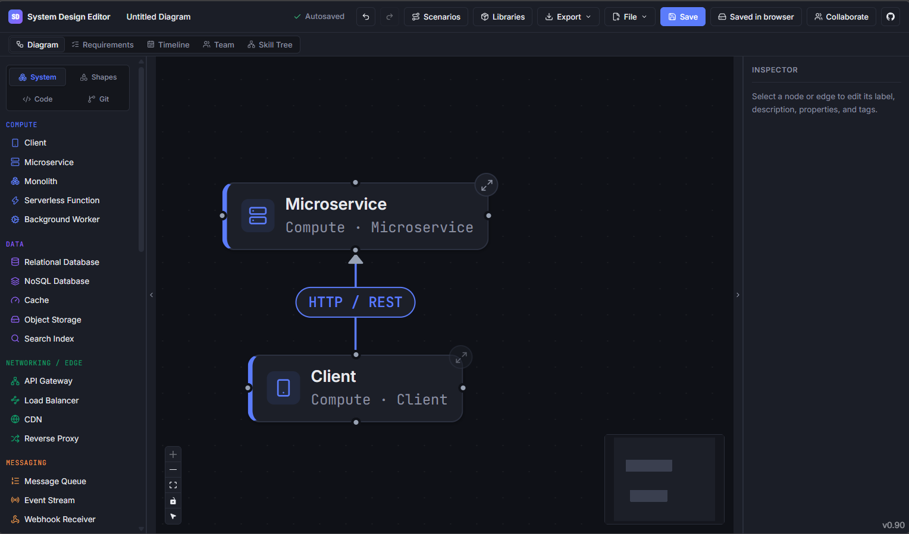
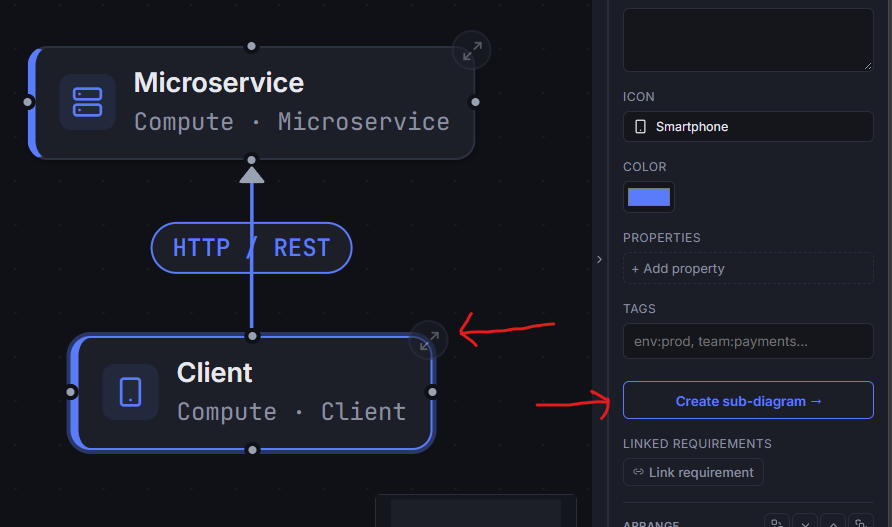
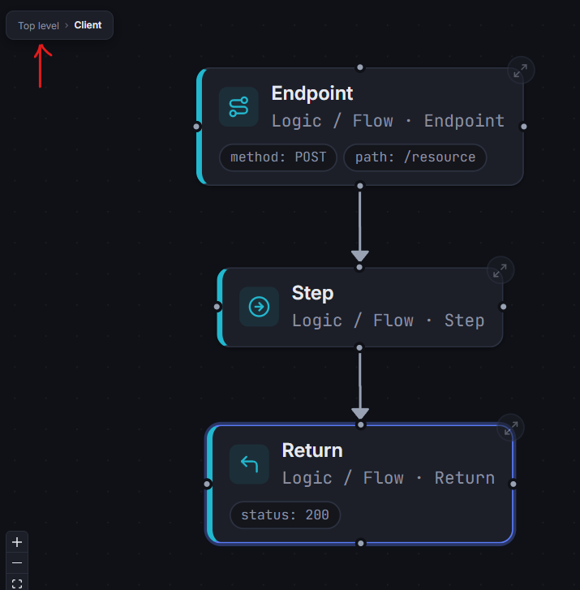
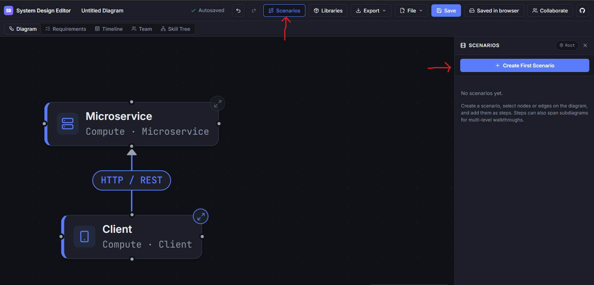
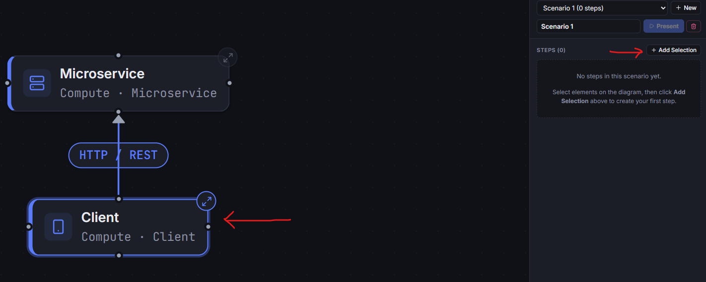
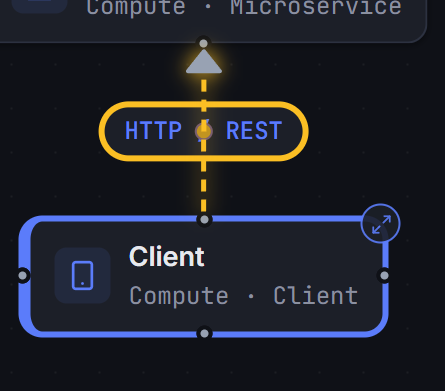
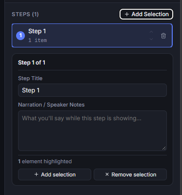
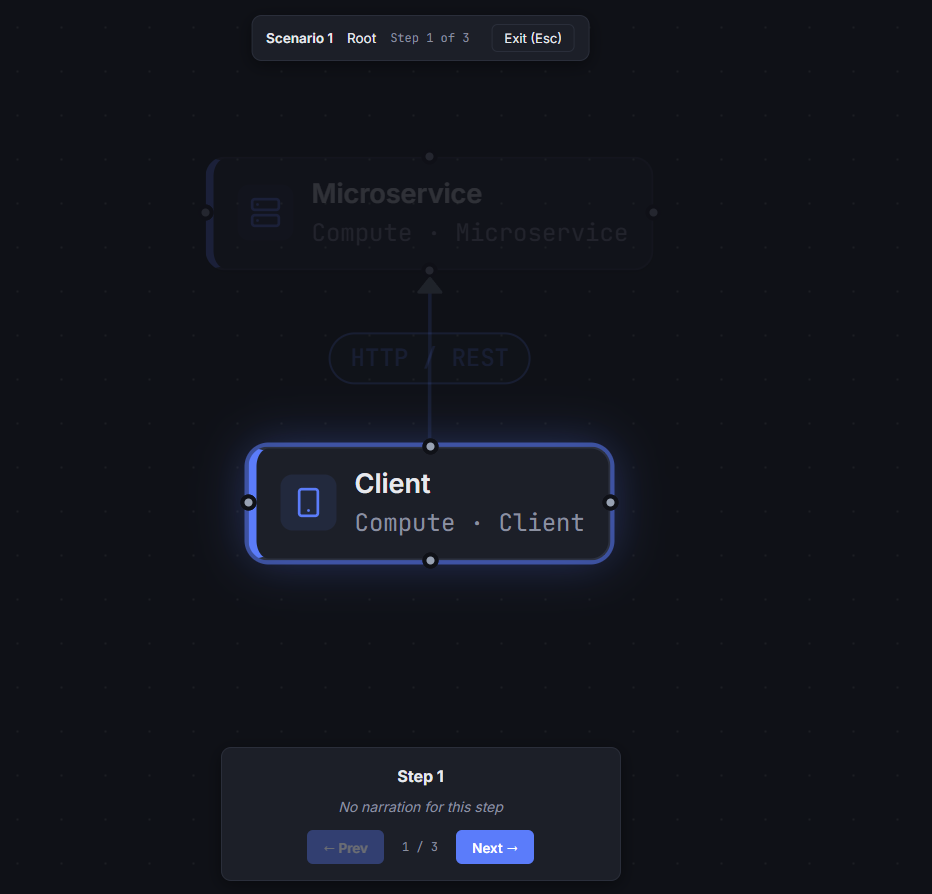
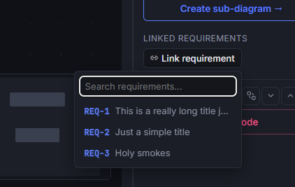

# Diagrams

The **Engineers Notebook** provides an interactive canvas tailored for architectural modeling, multi-tier system
visualization, and technical presentations. It combines the familiar drag-and-drop ergonomics of tools like Draw.io with
deep architectural primitives, hierarchical sub-diagrams, and dynamic presentation scenarios.

---

## 1. Canvas & Modeling Basics

The editor is designed for rapid, low-friction diagramming with zero configuration.

### Adding Components & Shapes

- **Palette**: Drag nodes and components directly from the left sidebar onto the canvas.
- **Architectural Nodes**: Choose from pre-configured system components (Microservices, Databases, Caches, Gateways,
  Message Queues, Clients, and Compute nodes).
- **Geometric Shapes**: Insert standard geometric shapes (Rectangles, Rounded Rectangles, Cylinders, Diamonds, Hexagons,
  and Cloud boundaries) for custom flowcharts and structural grouping.
- **Annotations & Snippets**: Add text callouts, sticky notes, and formatted code snippets to document decisions
  in-place.
- **Fragments**: Your own reusable groups of nodes - see [Reusable Fragments](#reusable-fragments) below.

### Reusable Fragments

A fragment is a group of nodes saved for reuse, like a "service + database + cache" trio you draw in every design.

1. Select the nodes, right-click, and choose **Save as fragment**. Give it a name and click **Save fragment**.
2. Switch the palette to **Fragments**. Drag a fragment onto any diagram, in any document - it lands with its top-left
   corner where you drop it, and becomes the selection so you can move it straight away.

A fragment brings along everything copying its nodes would: the connections between them, the contents of any
boundary, and every sub-diagram inside them. It leaves behind what only means something in the document it came from -
requirement links, document links and locks - and edge bends, which are redrawn where it lands.

Fragments are kept in this browser and shared by every document you open in it. Double-click a fragment's name in the
palette to rename it; click its bin icon twice to delete it.

### Connecting & Routing Edges

- **Connecting**: Press on any border of a node (or the outer edge of a boundary's border) and drag to another node.
  Release on one of its borders to attach to that side, or anywhere over it to attach to the nearest side. A highlight
  shows which side will be used before you let go. Dragging an existing edge's end works the same way.
- **Edge Types & Styles**: Customize connection pathways as directional, bi-directional, solid, dashed, or dotted.
- **Waypoints**: Click and drag mid-points on connection lines to insert bends and cleanly route edges around
  intervening components.
- **Flow Direction**: Set edge flow semantics, which dynamically drive data-flow animations during scenario playback.
- **Line Style**: In the Inspector, give an edge its own **Color** (the arrowheads follow it), **Thickness** (Thin to
  Heavy), and **Routing** - **Orthogonal** (right-angled, the default), **Straight**, or **Curved**. Bends work with
  every routing: a curved edge passes smoothly through each bend.

### Inspection & Customization

Select any component or edge to open the **Inspector Panel** on the right:

- **Labels & Descriptions**: Provide human-readable titles and markdown descriptions.
- **Icon Overrides**: Choose from the bundled Lucide icon catalog to match your exact technology stack.
- **Visual Styling**: Customize node accent colors, border styles, and Z-index layering.
- **Custom Properties & Tags**: Attach arbitrary key-value metadata and tags for categorizing systems.
- **Requirement Linking**: Bi-directionally link diagram elements directly to engineering requirements for traceability.
- **Locking**: Tick **Locked** to pin a node in place - it can't be dragged, nudged, resized or deleted until it's
  unlocked. Locked nodes show a small padlock.

### Editing Many Items at Once

Select several nodes and edges (Ctrl/⌘-click, or drag a selection box in select mode) and the Inspector edits **all of
them together**: color, icon, text size, node or boundary type, tags, linked requirements and lock for the nodes; type,
color, thickness, routing, direction and label visibility for the edges. A field whose items disagree shows **Mixed**
until you change it. Each change is a single undo step, however many items it touched.

### Aligning, Distributing & Matching Sizes

With two or more nodes selected, the **Align**, **Distribute** and **Match size** buttons at the top of the Inspector
(also under **Align & distribute** in the right-click menu) tidy them up in one step:

- **Align** left, center, right, top, middle or bottom - to the edge or center of the selection as a whole. Nodes
  inside different boundaries line up on screen.
- **Distribute** horizontally or vertically (three or more nodes) - the outermost two stay put and the rest are spaced
  with equal gaps between them.
- **Match** width, height or both - to the largest in the selection. Component nodes size to their content, so they
  set the size to match but aren't resized themselves; shapes, boundaries, text and code are.

Locked nodes never move or resize, but they still count: align a selection that includes a locked node and it acts
as the anchor the rest line up with. Positions and sizes are rounded to whole pixels, so lines stay crisp in SRD
exports, and each command is a single undo step.

### The Right-Click Menu

Right-click a node, an edge, or a selection for:

| Command                         | Shortcut         | What it does                                                                                                                      |
|---------------------------------|------------------|-----------------------------------------------------------------------------------------------------------------------------------|
| Change color / icon             |                  | Recolor (nodes and edges) or re-icon everything targeted.                                                                         |
| Align & distribute              |                  | Align, distribute or match the size of the selected nodes (see above).                                                            |
| Duplicate                       | Ctrl/⌘+D         | Copies the nodes (with their sub-diagrams and the edges between them) next to the originals, without touching the clipboard.      |
| Save as fragment                |                  | Saves the nodes (and what Duplicate would copy with them) to the palette's **Fragments**, for any document.                       |
| Group                           | Ctrl/⌘+G         | Wraps the nodes in a new boundary sized to fit them.                                                                              |
| Ungroup                         | Ctrl/⌘+Shift+G   | Removes a boundary and keeps what was inside it.                                                                                  |
| Lock / Unlock                   |                  | Pins nodes in place, or frees them again.                                                                                         |
| Copy style / Paste style        | Ctrl/⌘+Alt+C / V | Copies one item's color, icon, text size, thickness and routing and applies them to others. Color pastes between nodes and edges. |
| Link requirement                |                  | Searches requirements and toggles each one on every targeted node.                                                                |
| Bring to front ... Send to back |                  | Stacking order.                                                                                                                   |

---

## 2. Hierarchical Sub-Diagrams (Drill-Down)

Complex systems quickly become unreadable when flattened onto a single canvas. The sub-diagram engine allows you to
model high-level architectures at the root while encapsulating low-level implementation details in nested layers.

### How to Use Sub-Diagrams

1. **Creating a Sub-Diagram**:
   - Select any architectural node on the canvas.
   - In the right-hand Inspector panel, click **Create sub-diagram →** (or **Open sub-diagram** if one exists).

2. **Editing Nested Layers**:
   - The canvas transitions into the isolated sub-diagram view.
   - Add nodes, edges, and annotations specific to that component's internal architecture.

3. **Breadcrumb Navigation**:
   - A persistent breadcrumb bar at the top of the canvas (`Root › Service A › Worker Pool`) tracks your current
     abstraction level.
   - Click any breadcrumb segment to jump directly back to higher levels.

4. **Hierarchy Management**:
   - Deleting a parent node cleanly cascades and removes its underlying sub-diagram structure.

### Keeping Levels Connected (Boundary Ports)

Every connection to a node at its own level appears inside that node's sub-diagram as a **port** on the boundary,
much like the input and output pins of a collapsed graph in Unreal Engine's Blueprints:

- **Inbound ports** sit in a column on the left, one per edge pointing _at_ the node. **Outbound ports** sit on the
  right, one per edge leaving it. Each names the node at the other end and the connection's label or type.
- **Wire a port** by dragging from its pin to the node inside that handles the connection, or from that node onto the
  port. The wire runs the right way whichever end you start from, and takes on the connection's type.
- **Unwired ports** are drawn dashed in amber with a hollow pin. The parent node shows an amber badge with the number of
  connections not yet wired inside, and the Inspector repeats it - so the levels can't quietly drift apart.
- **Ports follow the level above.** Add an edge to the parent and a port appears inside; delete it (or move it to
  another node) and the port goes, along with any wire to it. One undo brings both back.
- **Wires carry on down.** A wire from a port into a node is itself a connection to that node, so if that node has its
  own sub-diagram, the connection shows up as a port there too - named after the node it really comes from, however
  many levels up.
- **Double-click a port** to go up to the level it comes from.

---

## 3. Scenarios & Presentation Mode

Static diagrams often fail to convey runtime execution order, request lifecycles, or failure failover paths. The
**Scenarios** feature turns diagrams into interactive, step-by-step presentations.

### Creating a Scenario

1. Click **Scenarios** (film icon) in the top toolbar or bottom tray to open the **Scenario Panel**.
2. Click **+ New Scenario** and give your scenario a descriptive title (e.g., _"User Authentication & Token Refresh
   Flow"_ or _"Payment Processing with Circuit Breaking"_).
3. Select the nodes and edges a step should highlight. The **Selection** bar under the step list shows how many are
   selected; click **New step from selection** to create a step from them.

4. To change an existing step, click it in the list to open it, select elements on the diagram, then click **Add to step
   N** or **Remove from step N** in the Selection bar. Each button is only enabled when it would change
   the step: Add when part of the selection isn't in the step yet, Remove when some of it is. While a step is open,
   the elements it already highlights are marked on the diagram, as are selected elements that would be added.

### Configuring Scenario Steps

For each step in the sequence:

- **Title & Narration**: Add an explanatory title and detailed speaker notes / walkthrough narration.
- **Focus Elements**: With the step open, select nodes and edges on the diagram and use **Add to step N** or **Remove
  from step N** in the Selection bar.
- **Level Context**: Steps can span different sub-diagram depths. When stepping into a component, the scenario
  automatically transitions to the appropriate sub-diagram level.
- **Reordering**: Use the **Up** / **Down** buttons in the step list to adjust sequencing.
- **Duplicating a step**: The copy button on a step inserts a copy right after it and opens it - handy when the next
  step is this one plus or minus a few elements.

### Building Variants of a Scenario

To walk through a variation of an existing flow (the same login, but with an expired token), click the copy button
next to **Present** and **Export**. The whole scenario is copied - every step, its narration, levels and highlighted
elements - as _"Title (copy)"_, and the copy opens so you can change only what differs. The original is untouched.

### Presenting to Stakeholders

Click **Present** to launch the presentation mode:

- **Targeted Camera Framing**: The viewport automatically pans and zooms to frame only the active step's components.
- **Atmospheric Dimming**: Components outside the current step are dimmed, focusing viewer attention strictly on active
  pathways.
- **Animated Data Flows**: Connected edges pulse with animated flow indicators in the configured direction.
- **Narrative Overlay**: A presentation bar displays step progress (`Step 3 of 8`), breadcrumb context, title, and
  detailed narration.
- **Controls**: Use `← Prev`, `Next →` buttons (or keyboard arrow keys) to step through flows, and press `Esc` to return
  to the editor.

### Exporting a Scenario

Click **Export** next to **Present** to take a scenario outside the editor. Each step is drawn exactly as Presentation
Mode shows it (the same framing, dimming and highlights), on a hidden canvas, so your own view never moves.

| Format           | What you get                                                                            | Best for                                  |
|------------------|-----------------------------------------------------------------------------------------|-------------------------------------------|
| **PDF slides**   | A 16:9 deck: an optional title slide listing the steps, then one slide per step         | Review meetings, attaching to a ticket    |
| **PNG images**   | One 1920×1080 image per step, numbered in order (`01-…png`), in a single `.zip`         | Pasting individual steps into other tools |
| **Animated GIF** | A 960×540 loop that plays the steps in order                                            | READMEs, wikis, Jira and Confluence pages |
| **MP4 video**    | A 1920×1080 H.264 video, which plays in browsers, PowerPoint, Keynote and media players | Embedding in slides, sharing in chat      |

Options:

- **Show the step title and narration**: adds a header (scenario, diagram level, step number) and a caption band with
  the step's title and narration to images and video. PDF slides always include them, as selectable text.
- **Time per step** (GIF and MP4): _Auto_ gives each step 3 to 15 seconds depending on how much there is to read; or
  pick a fixed time.
- **Fade between steps** (GIF and MP4): crossfades from one step to the next instead of cutting.

Notes:

- Narration longer than four lines is shortened with an ellipsis on slides, images and video. Keep the full text in the
  narration for live presenting.
- Focused edges are drawn highlighted but still: the flowing-dash animation is a live-presentation effect.
- If a step highlights something that has since been deleted, or points at a sub-diagram that no longer exists, the
  export dialog says so before you export, and those steps are exported without it.
- MP4 export needs a browser with WebCodecs video encoding (current Chrome, Edge, Safari and desktop Firefox). Where
  it isn't available the option is disabled; every other format works in any supported browser. If a browser can
  encode video but not H.264, the video is made in another codec and the dialog tells you.

Everything runs in your browser. The export uses only code and fonts served by your own deployment of the editor and
the browser's built-in video encoder. It contacts no outside service or CDN, so it works the same on an isolated or
air-gapped network.

---

## 4. Linking to Requirements

Architectural components do not exist in isolation; they implement specific functional, performance, and security requirements. The editor enables bi-directional traceability by allowing you to link any canvas node directly to existing engineering requirements.

### How to Link a Component to a Requirement

1. **Select a Component**: Click any architectural node or shape on the canvas to open the **Inspector Panel** on the right.
2. **Open the Linker**: In the Inspector panel, locate the **Linked requirements** section and click **+ Link requirement**.
3. **Search & Select**:
   - Type in the search box to filter existing requirements by their ID (e.g., `REQ-001`) or title keywords.
   - Click any requirement from the dropdown to link it to the selected component.
   - The dropdown stays open so you can link multiple requirements in succession.

### Managing & Navigating Linked Requirements

- **Color-Coded Badges**: Linked requirements appear as colored pills in the Inspector, reflecting their configured requirement type (e.g., Functional, Security, Reliability).
- **Jump to Requirement**: Click any requirement pill label to immediately switch to the **Requirements View** and focus on that requirement's full description, acceptance criteria, and metadata.
- **Unlinking**: Click the `×` button on any pill to remove the link from the component without modifying the requirement itself.
- **Bi-Directional Traceability**: Inside the **Requirements View**, each requirement card displays its connected diagram components under **Linked Diagrams & Components**, enabling team members to jump back and forth between design models and specifications.

---

## 5. Exporting Diagrams (SVG & PNG)

Diagrams can be exported as standalone vector graphics or high-resolution images for RFCs, wiki pages, presentations,
and technical documentation.

### Export Formats

| Format           | Best Used For                                       | Features                                                                |
| :--------------- | :-------------------------------------------------- | :---------------------------------------------------------------------- |
| **SVG** (Vector) | Web documentation, Markdown wikis, scalable print   | Infinite resolution scaling, crisp text, vector paths, small file size. |
| **PNG** (Raster) | Slide decks, messaging apps, tickets, email reports | High-DPI rasterization, universal image viewer compatibility.           |

### How to Export

1. Navigate to the diagram level you wish to export.
2. In the top-right toolbar, click the **Export** menu.
3. Select **Download SVG** or **Download PNG**.
4. The file automatically downloads using your diagram's document title.

---

## 6. Workflow Recommendations

- **Start Broad, Then Drill Down**: Use the Root level for system boundaries and service communication contracts. Drill
  down into sub-diagrams for internal class/module interactions or storage schemas.
- **Document Edge Semantics**: Label connection lines with protocols (e.g., `gRPC`, `HTTPS`, `Kafka Topic`) and assign
  distinct colors to separate synchronous calls from asynchronous event streams.
- **Pair Scenarios with Requirements**: Build scenario walkthroughs to validate acceptance criteria and review
  implementation flows with team members before coding.
- **Export to Markdown**: Embed exported SVGs into repository documentation to keep architecture specifications
  versioned alongside codebase changes.
