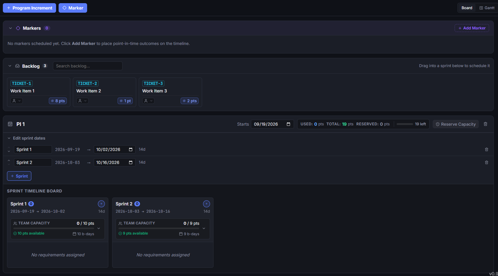
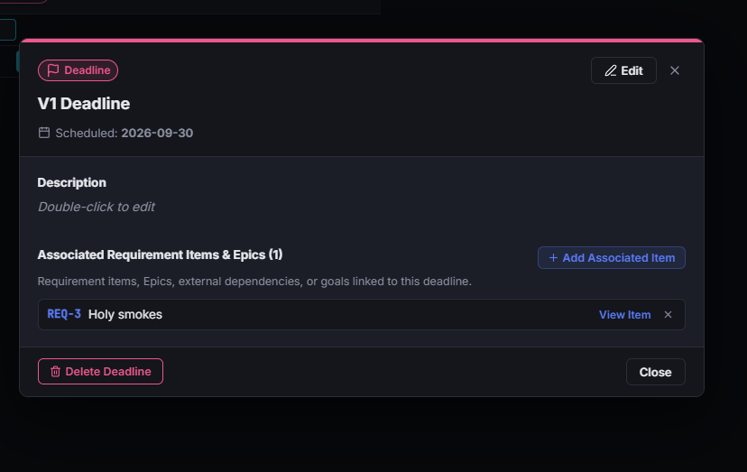
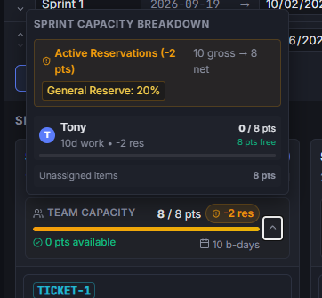
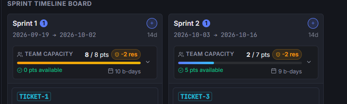
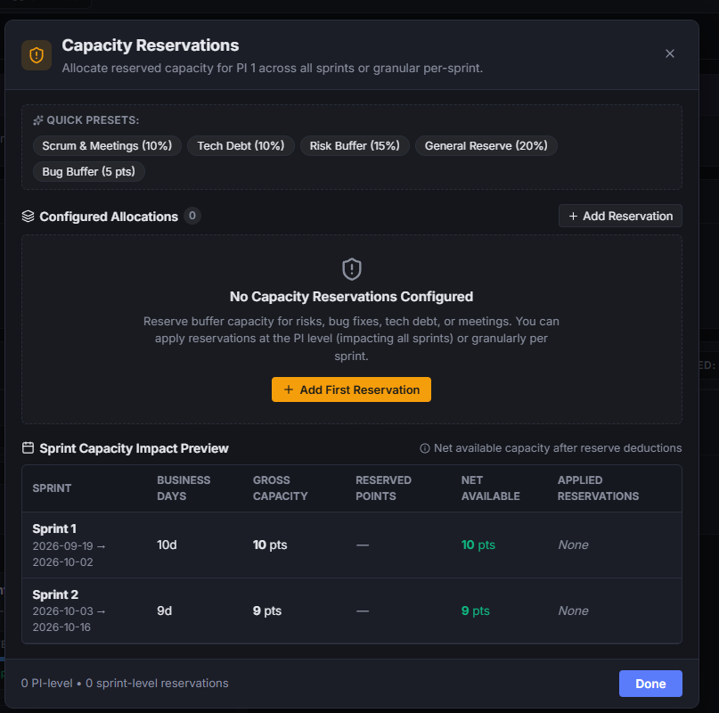
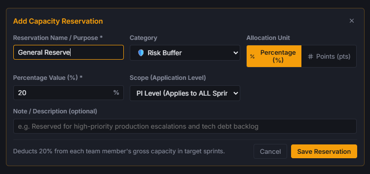
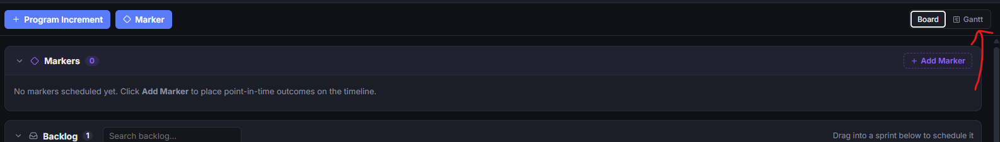
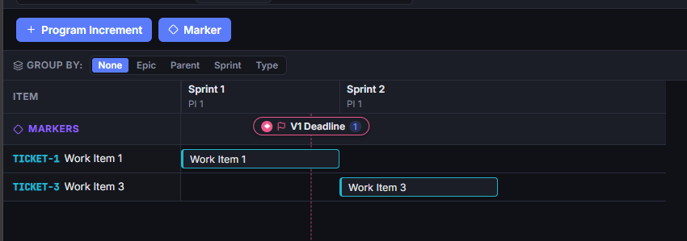
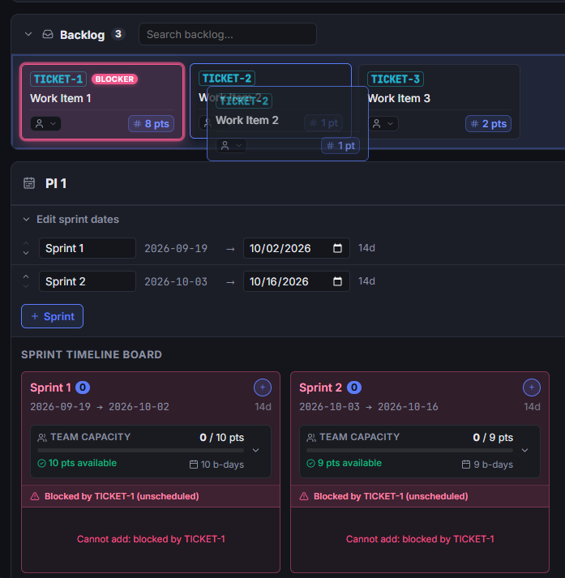
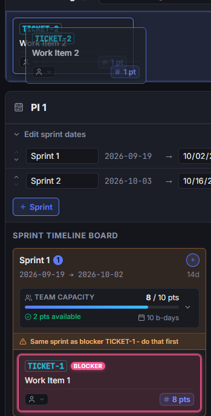

# Timeline & PI Planning

The **Timeline** module provides a collaborative Program Increment (PI) planning and sprint scheduling engine. Designed for agile engineering teams, it bridges high-level architectural roadmaps with tactical delivery schedules by combining drag-and-drop sprint boards, real-time team capacity management, date-based milestones, and interactive Gantt charts.

Planning lives under the **Plan** tab, which has four sections:

| Section          | What it is for                                                                         |
| ---------------- | -------------------------------------------------------------------------------------- |
| **Board**        | Program increments, sprint columns and the backlog. This page.                         |
| **Gantt**        | The same work laid out across sprints. See [Board and Gantt](#_5-board-and-gantt).     |
| **Dependencies** | Which items are done, ready or blocked. See [Dependencies](#_6-dependencies-blockers). |
| **Team**         | People, time off and capacity. See [Team & Capacity](/guide/team).                     |

The Plan tab reopens on whichever section you last used.

---

## 1. Program Increments & Sprints

Program Increments (PIs) provide multi-sprint planning intervals (typically 8–12 weeks) that align engineering delivery with architectural milestones.

### Adding a Program Increment

1. On the **Board**, click **+ Program Increment** in the toolbar.
2. The editor automatically initializes a new planning interval (e.g., `PI 1`, `PI 2`) starting seamlessly on the day following the previous PI's conclusion.
3. Sprints within the PI default to standard two-week (14-day) durations.

### Sprint Management & Cascading Dates

- **Edit sprints**: Sprint names and dates are folded away under **Edit sprints** on each PI, since they are set up once and rarely change. Click it to open the list.
- **Adding Sprints**: Click **+ Sprint** at the bottom of that list to add subsequent sprints.
- **Adjusting Durations**: Modify a sprint's end date from its row in the list.
- **Automatic Cascading**: Start and end dates for subsequent sprints automatically adjust when an earlier sprint is lengthened or shortened, keeping the timeline perfectly contiguous without manual re-calculation.

### Goals & Notes

- **PI goal and notes**: Every PI card has a goal line under its header and a **Notes** toggle for longer context -
  risks, decisions, dependencies.
- **Sprint goal and notes**: Click the target icon on a sprint row to set that sprint's goal and notes. Sprints with a
  goal show it under their name on the Sprint Timeline Board; hover it to read the notes.
- Goals are carried into the SRD roadmap: PI goals are listed above the sprint table and each sprint's goal has its own
  column.

---

## 2. Milestones & Date-Based Markers

Milestones represent critical temporal events, releases, regulatory checkpoints, and architectural gates across the delivery timeline.

### Creating a Milestone Marker

1. Click **+ Marker** in the timeline toolbar or click the milestone indicator on any sprint column.
2. Select the milestone category:
   - **Release** (`📦`): Planned software or capability release.
   - **Deadline** (`🚩`): Contractual, regulatory, or external target deadline.
   - **Review** (`📋`): Architecture, security, or stakeholder review gate.
   - **Launch** (`🚀`): Production go-live or public deployment.
   - **Code Freeze** (`❄️`): Stabilization cutoff date prior to deployment.
   - **PI Boundary** (`📅`): Planning interval transition marker.
3. Enter a title, scheduled calendar date, optional version tag (e.g., `v2.4.0`), and descriptive markdown notes.
4. Associate specific requirement items or delivery tickets with the milestone.

Milestones appear as distinctive colored point-in-time indicators on sprint headers and Gantt chart timelines.

---

## 3. Workable Item Assignment & Scheduling

The board has a backlog column on the left for scheduling unassigned actionable items (_Tickets_, _Workable Requirements_, etc.) into target sprints. It stays beside the sprints however far the board scrolls.

### Scheduling Items

- **Backlog column**: Lists every unassigned workable item, with a search box for long backlogs. Click the arrow in its header to fold it down to a narrow rail when you want the width for sprints; the rail still shows how many items are waiting.
- **Drag-and-Drop**: Drag tickets directly from the backlog into any sprint column, or drag items between sprints to re-sequence work. Drop a card on the backlog, folded or not, to take it out of its sprint.
- **Inline Editing**: Set story point estimates, update status (`To Do`, `In Progress`, `Done`), and assign team members directly on the sprint card.

### Choosing which sprints to show

The board shows every program increment and every sprint by default. To narrow it:

1. Pick a program increment from **Show** in the toolbar. Only that PI is shown.
2. Its sprints appear as buttons next to it. Click one to focus on that sprint alone, then click others to put them
   beside it. Click a selected sprint again to hide it.
3. **All sprints** shows the whole PI again; **All program increments** shows everything.

This suits teams that plan one sprint at a time as well as teams that plan several ahead. The choice is yours alone:
it is remembered per document in your browser, is not shared with collaborators, and only changes which columns the
board draws - capacity totals and the Gantt chart still cover every sprint.

### Real-Time Impact Preview

When dragging items across the board, the drop target displays a live impact preview.

The preview highlights projected point totals, updated capacity percentages, and immediate warning badges if the assignment introduces dependency order violations.

---

## 4. Capacity Planning & Reservations

Effective PI planning requires accounting for operational overhead, maintenance, and uncertainty rather than allocating 100% of raw developer bandwidth to new features.

### Configuring Capacity Reservations

Click **Reservations** on any PI to configure capacity buffers.

- **Reservation Units**: Allocate buffers as **Story Points** or as a **Percentage of Total Capacity** (e.g., `20%`).
- **Categories**: Tag reservations for specific operational needs:
  - **Risk Buffer**: Absorbs scope discovery and estimation variance.
  - **Bugs & Maintenance**: Accounts for incoming defect triage and production support.
  - **Technical Debt**: Dedicated refactoring, dependency upgrades, and infrastructure hardening.
  - **Meetings & Ceremonies**: Sprint planning, demos, and organizational overhead.
- **Scope**: Apply reservations globally across all sprints in the PI, or target individual sprints (e.g., reserving extra hardening capacity during a pre-release sprint).

### Live Sprint Capacity Bar

Every sprint column displays a live capacity gauge comparing planned story points against available net capacity. The bar updates dynamically as tickets are added, resized, or reassigned.

---

## 5. Board and Gantt

The Plan tab provides two views of the same schedule, tailored for sprint-level execution and executive roadmapping.

### Switching Modes

Click **Board** or **Gantt** in the Plan tab's section links to switch between:

- **Board View**: Columnar view organized by Program Increment and Sprint, optimized for backlog grooming and card dragging.
- **Gantt Chart**: Horizontal timeline visualizing work streams, epics, and milestone deadlines across months and quarters.

### Inferred Epic Scheduling

The Gantt chart automatically computes start and end spans for high-level Epics based on the scheduled dates of their underlying child tickets:

- **Automatic Date Spans**: An Epic's timeline bar spans from the start of its earliest child ticket's sprint to the conclusion of its latest child ticket's sprint.
- **Epic Filtering**: Use the Epic filter dropdown in the toolbar to isolate a single initiative across the timeline.

---

## 6. Dependencies & Blockers

Scheduling mistakes, such as scheduling a dependent ticket before its prerequisite is completed, are flagged automatically.

- **Schedule Conflict Warnings**: If Ticket B depends on Ticket A, but Ticket B is placed in an earlier sprint than Ticket A, the system flags the conflict with a visual warning badge (`⚠️`).
- **Risk Indicators**: Hovering over conflict badges displays the exact relationship chain and recommends re-scheduling adjustments.

### The Dependencies section

The **Dependencies** section of the Plan tab draws every workable item as a card, linked to the items it depends on
and laid out left to right in the order work can happen. Each card shows whether the item is done, in progress, ready
to start, or still waiting on something else, so it answers "what can we pick up next?" directly.

---

## 7. Collaborative PI Planning

During team-wide PI planning sessions, multiple engineers, architects, and product managers can work on the timeline simultaneously:

- **Live Peer Presence**: Colored presence avatars on sprint cards and detail modals show which items other participants are currently inspecting or editing.
- **Zero-Conflict Sync**: Sprint re-ordering, ticket assignments, and capacity adjustments propagate instantaneously across all connected clients via peer-to-peer WebRTC signaling.
